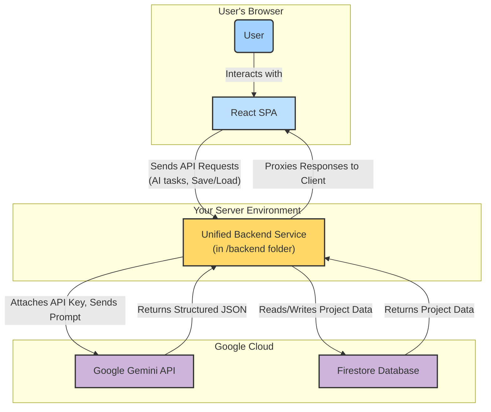

# High-Level Design (HLD)

This document outlines the high-level architecture of the AI Powered Interactive Hardware Lab™.

## 1. System Overview

The application is a full-stack project consisting of a client-side Single-Page Application (SPA) and a single, unified backend service. This architecture separates the presentation layer (frontend) from the business logic and data layers (backend), ensuring that sensitive operations like API key management and database access remain secure on the server side.

## 2. Core Architectural Components

The system is composed of four primary components:

1.  **Frontend (React SPA):** The user-facing application built with React. It manages the UI and client-side state, and communicates with the backend for all intelligent and data-persistence operations.

2.  **Backend Service (in /backend):** A unified service that handles all server-side logic.
    *   Acts as a secure proxy to the Google Gemini API, managing the API key and prompt engineering.
    *   Communicates with the Firestore database to handle all CRUD (Create, Read, Update, Delete) operations for user projects.

3.  **Google Gemini API (AI Service):** The intelligent engine that only communicates with our `backend` service. It generates project plans, evaluates code, and provides hints.

4.  **Google Firestore (Database):** A serverless NoSQL database that only communicates with our `backend` service. It stores and retrieves saved projects and admin configurations.

## 3. High-Level Architecture Diagram

The following diagram illustrates the secure, single-backend architecture.

