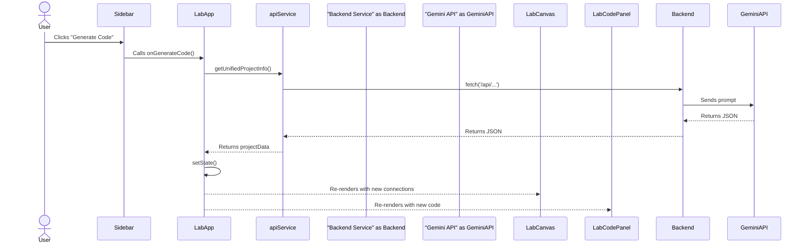

# Low-Level Design (LLD)

This document details the internal structure of the frontend application, its key components, and their interactions with the backend service.

## 1. Frontend Component Structure

The application is built using a modular, component-based architecture with React.

### Core Components

-   **`App.tsx`**: The root component. Acts as a router, controlling which main view (`Home`, `LabApp`, `AdminPage`, `AcademyPage`) is currently active.

-   **`LabApp.tsx`**: The main container for the interactive lab environment. It is the "controller" for a single project and manages all significant state.

-   **`Sidebar.tsx`**: The left-hand panel containing the component library, project inputs, and primary action buttons. It receives props and callbacks from `LabApp.tsx`.

-   **`LabCanvas.tsx`**: The central interactive workspace for rendering the board, components, and wires, and handling drag-and-drop logic.

-   **`LabCodePanel.tsx`**: The right-hand panel, hosting the Monaco Editor and displaying project explanations and connection lists.

### Service and Data Layer

-   **`services/apiService.ts`**: This service acts as the **API client for the project's backend**.
    *   It contains functions (e.g., `getUnifiedProjectInfo`, `saveProject`) that correspond to the backend's API endpoints.
    *   It uses the browser's `fetch` API to make requests to the backend service.
    *   It abstracts away all network communication from the UI components.

-   **`data/store.ts`**: A utility service for client-side logic.
    *   Handles saving and retrieving admin data (custom components/boards) from `localStorage`.
    *   Contains the `validateConnections` function for client-side circuit validation.

## 2. Component Interaction Diagram (Sequence)

This diagram shows the sequence of events when a user clicks "Generate Code," illustrating the full-stack architecture.

## 3. State Management

-   **Primary State Holder:** The `LabApp.tsx` component acts as the central source of truth for the entire lab session.
-   **Data Flow:** State is passed down to child components (`Sidebar`, `LabCanvas`, `LabCodePanel`) via props.
-   **State Updates:** Child components use callback functions (passed as props) to notify `LabApp.tsx` of events (e.g., `onGenerateCode`, `onDrop`, `onUserCodeChange`). This follows a standard unidirectional data flow pattern, making the application predictable and easier to debug.